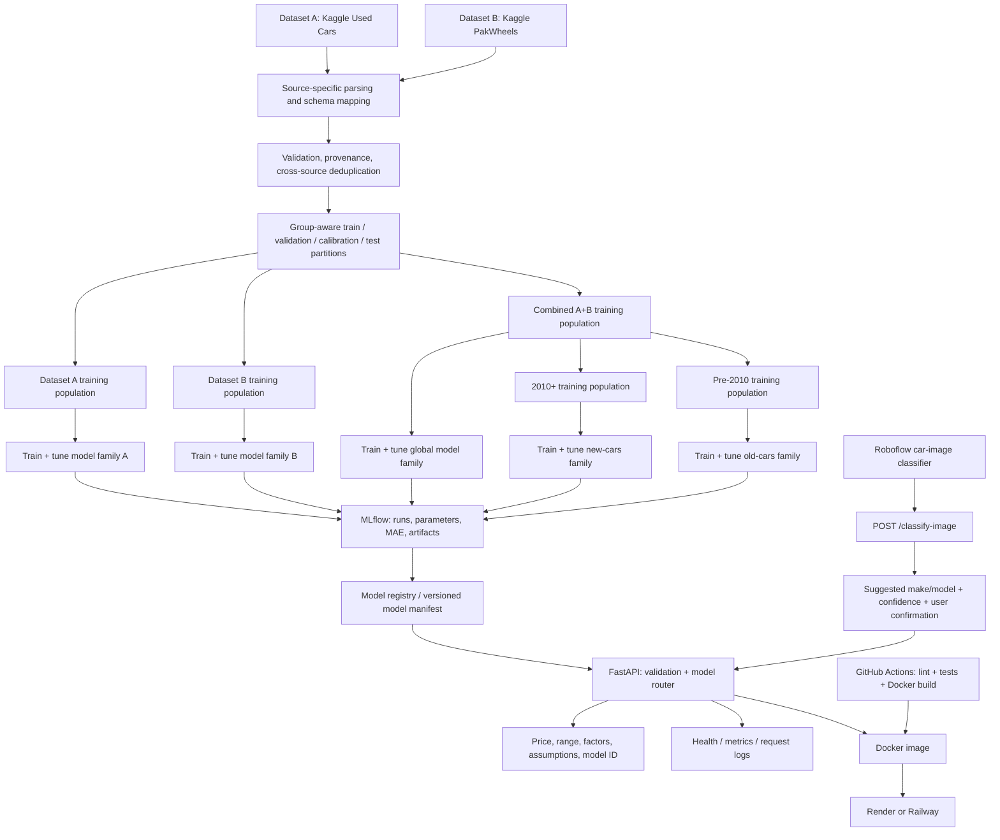
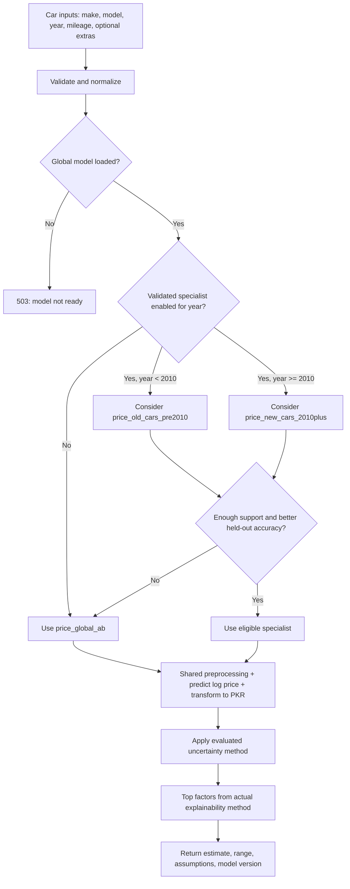

# CarCompass — Proposed Multi-Model Architecture

**Status:** Design proposal, informed by the uploaded CarCompass repository and the supplied course requirements.  
**Date:** 5 November 2026  
**Objective:** Estimate Pakistani used-car asking prices in PKR using structured listing data, optionally assisted by a car-image classifier, while retaining a reproducible MLflow + FastAPI + Docker + CI/CD workflow.

> **Disclaimer:** Predictions reflect historical advertised asking prices, not verified sale prices, guaranteed market valuations, or appraisals.

## 1. Executive proposal

Keep **five named price-model candidates** and **one separate computer-vision model**:

| Logical name | Stable model ID | Training data | Role | Initially exposed to users? |
|---|---|---|---|---|
| Global A+B | `price_global_ab` | Harmonized, deduplicated A ∪ B | Default price model; candidate production champion | Yes, after evaluation |
| Dataset A | `price_dataset_a` | Dataset A only | Source-specific benchmark and fallback candidate | No, initially |
| Dataset B | `price_dataset_b` | Dataset B only | Source-specific benchmark and fallback candidate | No, initially |
| New Cars | `price_new_cars_2010plus` | Cars with `year >= 2010` from eligible A+B rows | Era specialist | Only if validated |
| Old Cars | `price_old_cars_pre2010` | Cars with `year < 2010` from eligible A+B rows | Era specialist | Only if validated |
| Car Vision | `vision_car_classifier` | Roboflow project's own labeled image dataset | Predict car make/model class from a photo, not price | Optional image endpoint |

**Important:** A model *family* (A, B, A+B, New, Old) describes the training population, whereas an *algorithm* (median baseline, Ridge, Random Forest, LightGBM) describes the estimator. Each family may run several algorithms/hyperparameters; MLflow identifies a champion **within each family**. The production router must be based on independent evidence, not an assumption that a specialist is better.

The pre/post-2010 partition is initially a **proposed hypothesis**, not an empirically established optimal threshold. “New” means *2010 or later in this experiment*, not necessarily a newly manufactured vehicle.

## 2. Data sources and provenance

- **Dataset A:** Pakistan Used Cars Dataset — https://www.kaggle.com/datasets/muhamedumarjamil/pakistan-used-cars-dataset
- **Dataset B:** Pakistan's Largest PakWheels Automobiles Listings — https://www.kaggle.com/datasets/asimzahid/pakistans-largest-pakwheels-automobiles-listings
- **Image classification:** Car Model Computer Vision Model — https://universe.roboflow.com/pakistani-car-detection/car-model-aroud-zmz1t

Kaggle URLs and names were checked, but this architecture does **not** assume the complete datasets' row counts, licenses, coverage periods, quality, or accuracy without downloading and auditing the actual files. Record each source's permissions/license and citation before redistribution or training.

Roboflow's public page identifies a classification task, 50 classes, an MIT label and an advertised 99.8% accuracy. **That headline metric is not independently validated for CarCompass user photos** and must not be represented as our accuracy. The page contains differing image counts between summary and model dataset; verify the actual model version and dataset export. Roboflow model ID shown: `car-model-aroud-zmz1t/1` (check access and deployment terms before use).

### Shared canonical listing schema

```text
make, model, year, mileage, price, engine_cc, transmission, fuel, city,
listing_group, source_dataset, source_record_id, scraped_at (when available)
```

**Source-specific canonical mapping examples:**

| Input | Example | Canonical output |
|---|---|---|
| Price string | `2.0 lacs` | `price=200000` PKR |
| Price string | `8.5 lacs` | `price=850000` PKR |
| Mileage string | `106,000 km` | `mileage=106000` kilometers |
| Engine | `800 cc` | `engine_cc=800` |
| Fuel | `CNG`, `Cng` | `fuel=CNG` |
| Name | `Toyota Corolla XLI 1.3` | `make=Toyota`, `model=Corolla`, optional variant stored separately |
| Source | Dataset A or B | `source_dataset=A` or `B` |

Example rows provided in the conversation are **illustrations**, not proof of the real datasets' full contents. The first CSV example already resembles processed data; the second is a raw representation. These should **not** automatically be counted as two distinct datasets.

**Data quality rules:** parse currency and units, check year/mileage/price/engine ranges, reject missing required fields, standardize case/spelling, inspect extreme outliers rather than blindly removing legitimate expensive cars, and retain provenance. Inspect whether year is manufacture year rather than listing year. If `city` is actually a province in Dataset B, retain its true meaning and do **not** silently compare provinces to cities. If listing dates exist, account for inflation/market timing and consider a time-based holdout; older nominal PKR asking prices can be substantially different from current nominal prices.

## 3. Full architecture (Mermaid diagram)



### Separate online request flow



**No price-model averaging by default.** The above is a *selection/router architecture*. Combining predictions into an ensemble is a separate experiment and requires comparable out-of-sample evaluation and calibration.

## 4. Training design and fair comparisons

1. **Acquire and fingerprint datasets** with content hashes, source information and extraction dates; never commit large data exports or API secrets.
2. **Harmonize first**, preserving `source_dataset` and checking source-specific schema peculiarities.
3. **Deduplicate across A and B**, including near-duplicates, before creating splits. Prevent a repeated listing from appearing in training and testing.
4. **Create one global group-aware evaluation partition** across deduplicated A+B and store split IDs. For a temporal generalization study, additionally hold out the newest listings if reliable timestamps exist.
5. **For each family**, select only eligible *training* rows; use train-only inner validation for hyperparameter tuning. Compare all candidates on relevant *held-out* examples using the **same evaluation rows** wherever feasible. An A-only model should be assessed on the global test set as well as source-specific subsets.
6. **Algorithms per family:** baseline median, Ridge, Random Forest, LightGBM, with documented hyperparameters. Initial proposal: all four algorithm types for each family where data supports them; minimum 3 logged runs already met by the repository's provided config if executed successfully.
7. **Primary selection metric:** MAE (PKR), with MdAPE as secondary. Report count, test coverage, and MAE by source, manufacture era and make/model where sample sizes permit. Set minimum-support safeguards rather than assuming 30 observations is adequate.
8. **Prediction intervals:** separate calibration data from model selection/test data. Evaluate empirical coverage of the claimed 10th–90th bounds and width on the untouched test set. Methods may include held-out residual quantiles or conformal approaches, but must be checked for skew and drift.
9. **Choose champion per family** using validation results. **Do not choose the production champion based on test MAE**; reserve final test results for unbiased reporting.
10. **Register and version** models with source, data hash, split hash, feature schema, algorithm, MAE, interval coverage, code commit and model artifact. Use an explicit router config to enable/disable specialists after evidence-based comparison.

### Suggested MLflow naming

| MLflow experiment | Example run name | Registered artifact / alias suggestion |
|---|---|---|
| `CarCompass/price_global_ab` | `lightgbm_600_lr03` | `carcompass-price-global-ab` |
| `CarCompass/price_dataset_a` | `random_forest_depth16` | `carcompass-price-dataset-a` |
| `CarCompass/price_dataset_b` | `ridge_alpha_1` | `carcompass-price-dataset-b` |
| `CarCompass/price_new_cars_2010plus` | `lightgbm_300` | `carcompass-price-new-2010plus` |
| `CarCompass/price_old_cars_pre2010` | `random_forest_depth12` | `carcompass-price-old-pre2010` |
| `CarCompass/vision_car_classifier` | `roboflow_external_v1_eval` | Metadata and independent inference evaluation; not a locally trained price regressor |

A deployment can use a versioned **model manifest**, e.g. `models/manifest.json`, pointing logical names to verified artifacts. A “production” alias should identify what is actually deployed, not be assigned to every experimental model.

## 5. Image classifier integration

The Roboflow model is **not** a replacement for price regression.

**Intended user journey:**

1. User submits car photo to `POST /classify-image`.
2. Backend validates file size, extension, decoded image format, request rate, and permissions; calls the configured classifier securely without exposing API keys to the client.
3. Backend maps the returned class, e.g., a variant/year-style label, to a **candidate make/model** in CarCompass's canonical vocabulary.
4. API returns candidate label(s) and confidence if supplied. **Require user confirmation**, especially for make/model ambiguity. A class suffix such as `2018` is not proof of the precise registration or manufacturing year.
5. User supplies or confirms **year and mileage** (not reliably established by a photograph) and any optional attributes.
6. Normal `/predict` route estimates price using the structured model; include `image_assisted=true` and confidence/source metadata as appropriate.
7. If the image model is unavailable or uncertain, return a clear classification failure or “manual input required”; the standard price API should continue working.

**Validation gates:** verify true model capabilities, actual supported classes, license/deployment terms, performance on Pakistani real-world user images, latency, cost, API security, and robust mapping of class names. The advertised Roboflow accuracy is not enough to claim accuracy for this integration.

## 6. Business logic and model routing

**Required input:** make, model, year, mileage.  
**Optional input:** engine_cc, transmission, fuel, city, subject to whether training data genuinely includes these consistently.  
**Outputs:** predicted price PKR, lower/upper estimated range, assumed fields, most important supported factors, selected model ID/version and warning about asking prices.

**Router (proposed):**

```python
# Illustrative pseudocode, NOT a drop-in patch

def choose_price_model(request, registry, routing_policy):
    global_model = registry.require("price_global_ab")
    era_name = (
        "price_old_cars_pre2010" if request.year < 2010
        else "price_new_cars_2010plus"
    )
    specialist = registry.get(era_name)
    if (
        routing_policy.is_enabled(era_name)
        and specialist is not None
        and routing_policy.has_validated_gain(era_name)
        and specialist.supports(request)
    ):
        return specialist
    return global_model
```

Dataset A/B models remain **explicit research candidates**, not defaults selected merely from a user-car feature. Optional `/predict?model_id=price_dataset_a` should only be available to authorized/internal evaluators if added. Source datasets cannot be inferred from the customer's car and should not be treated as routing categories.

**Missing fields:** impute with statistics fitted on training data only; flag them in `assumed_fields`. Never promise narrower uncertainty just because optional fields are present; test calibration across input patterns. Return a useful validation error for unknown make/model or unsupported ranges instead of a confidently invented estimate.

## 7. Proposed APIs

| Route | Intent | State in uploaded repository |
|---|---|---|
| `POST /predict` | PKR point estimate, interval, assumptions, selected model/version | Present; extend routing |
| `POST /explain` | Above plus supported top factors | Present; extend model-aware explanations |
| `GET /health` | Liveness/readiness indicator | Present; distinguish readiness if useful |
| `GET /metrics` | Counts, latency, errors | Present |
| `GET /docs` | OpenAPI docs | FastAPI-generated |
| `POST /classify-image` | Roboflow car class candidates | **Proposed, not present** |
| `GET /models` | Versions of available model families; avoid sensitive operational data | **Optional proposed** |

**Example proposed response** (values purely illustrative; not a real price estimate):

```json
{
  "estimated_price_pkr": 1500000,
  "price_range_pkr": {"low": 1300000, "high": 1750000},
  "selected_model": "price_new_cars_2010plus",
  "model_version": "<resolved-version>",
  "assumed_fields": ["engine_cc", "transmission", "fuel", "city"],
  "top_factors": ["<computed-factor-1>", "<computed-factor-2>"],
  "disclaimer": "Historical asking-price estimate; not a valuation."
}
```

The example specialist selection assumes the necessary validation gates have passed.

## 8. Proposed repo changes (incremental; keep the existing code)

```text
CarCompass/
├── configs/
│   ├── schema.yaml                 # existing: source mappings; expand per source
│   ├── data.yaml                   # existing: source acquisition configuration
│   ├── train.yaml                  # existing: algorithm/hyperparameter experiments
│   ├── model_families.yaml         # NEW: A / B / AB / 2010+ / pre-2010 definitions
│   └── routing.yaml                # NEW: controlled routing and fallback policies
├── src/
│   ├── prepare_data.py             # existing: add source-aware combined preparation
│   ├── train.py                    # existing: expand explicit five-family training
│   ├── model_utils.py              # existing: shared feature transforms and loader
│   ├── app.py                      # existing: add optional image route, model IDs
│   ├── model_router.py             # NEW: safe family selection and fallback
│   ├── vision_client.py            # NEW: Roboflow adapter and label normalization
│   └── evaluate_families.py        # NEW: comparable model reports and gate checks
├── models/
│   ├── manifest.json               # NEW: versions, paths, hashes, supported features
│   ├── price_global_ab.joblib       # generated
│   ├── price_dataset_a.joblib       # generated
│   ├── price_dataset_b.joblib       # generated
│   ├── price_new_cars_2010plus.joblib # generated
│   └── price_old_cars_pre2010.joblib  # generated
├── tests/
│   ├── test_prepare_data.py        # existing
│   ├── test_api.py                 # existing
│   ├── test_model_loading.py       # existing
│   ├── test_model_router.py        # NEW
│   ├── test_combined_dedup.py      # NEW
│   └── test_vision_client.py       # NEW: mocked API; no live key in CI
├── .github/workflows/            # ensure CI lint, tests, Docker build
├── Dockerfile
├── README.md
├── RUNBOOK.md
├── CONTRIBUTION.md
└── AI_USAGE.md
```

### Example `configs/model_families.yaml` (proposed)

```yaml
families:
  price_global_ab:
    sources: [A, B]
    filter: all
    deployment_role: default
  price_dataset_a:
    sources: [A]
    filter: all
    deployment_role: benchmark
  price_dataset_b:
    sources: [B]
    filter: all
    deployment_role: benchmark
  price_new_cars_2010plus:
    sources: [A, B]
    year_min: 2010
    deployment_role: conditional_specialist
  price_old_cars_pre2010:
    sources: [A, B]
    year_max: 2009
    deployment_role: conditional_specialist
vision:
  name: vision_car_classifier
  provider: roboflow
  model_id: car-model-aroud-zmz1t/1
  enabled: false  # enable after independent validation and secure configuration
```

## 9. Existing code assessment — verified from uploaded `CarCompass.zip`

The project is **not starting from zero**:

- `configs/train.yaml` has **12 configurations**: 3 baseline, 3 Ridge, 3 Random Forest, 3 LightGBM.
- `src/train.py` already includes `ERA_YEAR = 2010` and era artifact names `price_model_pre2010.joblib` and `price_model_2010plus.joblib`; it has an experimental era-model path. It is **not yet evidence that those specialists are deployed or superior**.
- `src/train.py` can register the global champion under `carcompass-price` with alias `production` when properly configured.
- `src/prepare_data.py` includes price/mileage parsing, deduplication and group-aware splitting.
- `src/app.py` defines `/predict`, `/explain`, `/health`, and `/metrics`.
- The supplied ZIP contains model joblib artifacts and a local MLflow database; their presence does **not** establish successful evaluation on both real Kaggle datasets.
- The existing training header says the lowest **test** MAE becomes champion. **Change selection to use validation performance and reserve test for final reporting.**
- The existing `MIN_ERA_ROWS = 30` is a feasibility guard, **not evidence of statistical reliability**.
- There is no `/classify-image` route in the inspected `src/app.py`.

This architecture proposal does not claim that `price_global_ab`, `price_dataset_a`, or `price_dataset_b` already exist as trained artifacts.

## 10. Implementation phases and milestones

### Phase 1 — reliable core (priority)

- [ ] Verify licensing and actual schemas of both Kaggle exports.
- [ ] Add `source_dataset`, provenance and reliable A/B/A+B deduplication.
- [ ] Lock reproducible group-aware partitions and confirm no leakage.
- [ ] Train and log global A+B models and choose champion on validation data.
- [ ] Report untouched-test MAE (PKR), MdAPE and interval coverage.
- [ ] Confirm FastAPI endpoints, tests, Docker image, GitHub Actions and hosted URL.

### Phase 2 — source and era experiments

- [ ] Train `price_dataset_a`, `price_dataset_b`, `price_new_cars_2010plus`, `price_old_cars_pre2010` using consistent experimental protocols.
- [ ] Compare test metrics overall and per relevant subgroup, with uncertainty and sample counts.
- [ ] Register artifact versions and create a model manifest.
- [ ] Enable router only if specialists improve appropriately evaluated cases; otherwise default to global.
- [ ] Add tests for missing artifact, 2010 boundary, unsupported car and fallback.

### Phase 3 — optional vision integration

- [ ] Confirm Roboflow API availability/terms and access mechanism.
- [ ] Build server-side vision adapter and label-to-make/model mapper.
- [ ] Independently test recognition accuracy and confidence on relevant photos.
- [ ] Add `/classify-image`, upload security, timeouts, error handling and user confirmation.
- [ ] Demo photo → suggested make/model → confirmed details → price estimate.

### Phase 4 — operations and documentation

- [ ] Make model versions, metrics and readiness observable in logs or status endpoints.
- [ ] Document rollback to prior image/model version in `RUNBOOK.md`.
- [ ] Pin dependencies, manage secrets through hosting platform, and monitor costs/latency.
- [ ] Update README architecture, experiment results, credits, AI usage and contributors.

**Course alignment:** The supplied project instructions prioritize a reproducible **single** ML system with tracked experiments, FastAPI, Docker, CI, deployment and monitoring. Keep the multi-family experiments and vision model as improvements, not blockers for the required end-to-end demo. In particular, the course's final presentation also requests demonstration of `/predict` and `/explain`.

## 11. Acceptance criteria

- A fresh environment can reproduce training and service startup with documented commands.
- All five **named** price families have explicit definitions and experiment records; a family may be rejected/disabled if data is insufficient.
- The chosen production model has reproducible version, source and evaluation metrics.
- No shared listing or near-duplicate leaks across train/test.
- Price estimate is in PKR; input units are explicit; assumptions, range and model ID are returned.
- Family routing selects only eligible, validated artifacts and always has a working documented fallback.
- The vision path does not invent mileage, precise year or price from an image.
- Tests, CI, Docker build, live API, monitoring and rollback are demonstrable.

## 12. References / source links

1. Dataset A: https://www.kaggle.com/datasets/muhamedumarjamil/pakistan-used-cars-dataset
2. Dataset B: https://www.kaggle.com/datasets/asimzahid/pakistans-largest-pakwheels-automobiles-listings
3. Roboflow model: https://universe.roboflow.com/pakistani-car-detection/car-model-aroud-zmz1t
4. Source code: uploaded `CarCompass.zip` (inspected files: `src/train.py`, `src/prepare_data.py`, `src/app.py`, `configs/train.yaml`, `configs/schema.yaml`).
5. Course constraints: user-provided MLOps semester project requirements.

---

**Decision:** Build `price_global_ab` as the primary candidate, retain `price_dataset_a` and `price_dataset_b` as benchmarks, evaluate `price_new_cars_2010plus` and `price_old_cars_pre2010` as gated specialists, and integrate Roboflow classification through an **independent optional vision service**. The final production combination will be decided by leakage-safe evaluation, not by model names or apparent complexity.
